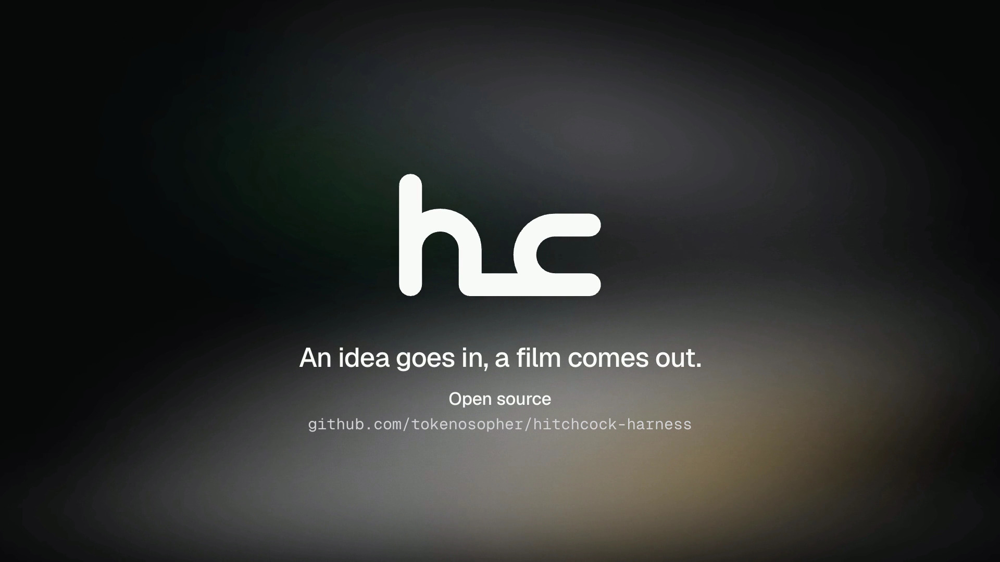

# Hitchcock Harness

<!-- The walkthrough video. For a player right here: open this file in the editor on github.com, drag the video file into it, and put the https://github.com/user-attachments/assets/… link that GitHub writes alone on its own line, in place of the poster line below. -->
[](https://github.com/tokenosopher/hitchcock-harness/releases/download/v0.2.0/hitchcock-harness-walkthrough.mp4)

> "Once the screenplay is finished, I'd just as soon not make the film at all. … When you finish the script, the film is perfect. But in shooting it you lose perhaps 40 per cent of your original conception."
>
> [Alfred Hitchcock, to Roger Ebert, 1969](https://www.rogerebert.com/interviews/hitchcock-never-mess-about-with-a-dead-body-you-may-be-one)

Hitchcock Harness takes him at his word: you get the film right on paper, and the app does the shooting.

Hitchcock Harness is an app on your Mac for making short AI films. You talk to an AI assistant called Alma in a chat that runs the whole film: you give her an idea, she writes the story and the script with you, makes the characters, voices and places on Higgsfield, lays out every scene, and asks you before the videos are made. The app shows the film as it grows (story, characters, locations, scenes, the edit, the release) and lets you pick, say yes or give a go with buttons. Alma is Claude Code running on your own Claude login; the pictures, voices and videos are made on your own Higgsfield account. Nothing in the app holds a key or a password, unless you add the optional reserve key (below): both sign-ins stay with Claude Code.

New here? After installing, read GUIDE.md: your first film, step by step.

## What you need

- **A Mac.** (Linux may work; it is not tested.)
- **A Claude account with Claude Code.** The Max plan is recommended: Alma and her helper agents run for a long time on a film.
- **A Higgsfield account with credits.** Every picture, voice and video is made there and paid in Higgsfield credits. If you don't have one yet, here is an affiliate link: [higgsfield.ai](https://higgsfield.ai?fpr=zero-brainy). It helps support Hitchcock Harness if you use it to subscribe.
- These free programs on your Mac (the install below gets them all):
  - **Homebrew**, which installs the others. If you do not have it, get it from [brew.sh](https://brew.sh).
  - **Node**, which runs the app itself.
  - **ffmpeg**, which cuts, joins and renders the video and sound.
  - **Python**, which runs the studio's small tools (contact sheets, checks, the film's folders).
  - **Blender**, which Alma uses to lay out the rough preview of each scene (the previz). Everything before the previz works without it.
  - **uv**, which installs and runs the two tools that work on your Mac for free: removing the music from a sound (Demucs) and timing each spoken word (Whisper).

## Install

1. Open the Terminal app and install the programs:
   ```bash
   brew install node ffmpeg python git uv
   brew install --cask blender
   ```
2. Install Claude Code, if you have not yet, and sign in once:
   ```bash
   curl -fsSL https://claude.ai/install.sh | bash
   claude
   ```
   Follow the login in your browser, then type `/exit`.
3. Get the app and run the setup:
   ```bash
   git clone https://github.com/tokenosopher/hitchcock-harness
   cd hitchcock-harness
   ./setup.sh
   ```
   The setup checks the programs, makes the folders the films live in, installs what the app needs (the local tools for removing music and timing words included, which can take a few minutes the first time) and adds Higgsfield to Claude Code. You can run it again at any time; it only adds what is missing.
4. Sign in to Higgsfield, once:
   ```bash
   claude
   ```
   Type `/mcp`, pick **higgsfield** and sign in with your Higgsfield account. Then type `/exit`.

## Start

In the Terminal, in the app's folder:

```bash
npm run dev
```

Then open **http://localhost:8800** in your browser. Leave the Terminal window open while you work; press Ctrl-C there to stop the app.

## Make your first film

1. Press **New film** at the top left.
2. Give it a title and paste your idea in your own words. The rest of the form (9:16, a budget of 5,000 credits, Higgsfield voices, 1080p by Seedance 2.5) is already filled in; change only what you want different.
3. Press **Start the film**. Alma makes the film's folder and writes a first story. Read it on the Story page, change it yourself or ask her to, and tell her when it is settled. Then she writes the script.
4. From then on, Alma puts every choice in front of you as a card under **Waiting for you**: pick a face, a voice, a place, say yes to a script. Answer with the buttons, or just write to her.

Every step of a film opens with a few words from Alma: what you do there and why it comes at that point. **Hide**, after her last word, hides that step's intro, and **Show intro**, left in its place, brings it back. The **Step intros** switch in Settings turns all of them off, or back on.

## How spending works

- Each new film starts with a budget of **5,000 Higgsfield credits** (change it on the New film form).
- Alma quotes in **Higgsfield credits** before she spends.
- Once you lock the script, she makes the first round of pictures and voices (faces, clothing, places, voices, the rough previews of each scene) without asking again, and tells you each round's size and cost.
- **There is one hard stop before the videos.** When every character, place and scene prompt is ready, she stops and asks "Go for the video?" with the total. You review every scene, its prompt and what goes into it on the **Go for the video** page before you say go.
- Everything after that (another round, a redo of a take, the 1080p of each take in Seedance 2.5) gets its own quote and waits for your yes.
- Every paid job is written down in the film's `spend.md`, and the total shows at the top of the film's pages.

**Optional: the reserve key.** If your Claude plan's limit stops Alma mid-film, she can run on API credits instead. Put an API key from your Claude Console organization in `.env.local` as `HARNESS_RESERVE_API_KEY=…` (never in `.env.example`, never committed), then turn on **Settings → Reserve: API credits**. It is off by default, and off again with the same switch; while it is on, Alma's turns are paid from your API credits and the page shows the month's spend.

## A word on safety

Alma runs Claude Code with its permission prompts turned off, because nobody sits at a terminal to answer them. She works inside the app's `studio` folder. She is told never to delete anything without your yes on that exact name, never to overwrite a picture, a video or a version of the cut, and never to spend outside the rules above. If you want her to ask before anything but file edits, set `HARNESS_ALMA_PERMISSIONS=ask` in `.env.local` and restart the app. The app only answers on this Mac.

## Where things are

| Where | What |
|---|---|
| `studio/assets/films/<film>/` | Each film: its story, script, pictures, voices, takes, the cut, the record of what was spent |
| `studio/assets/library/` | Faces, voices, characters and places saved to use again in later films |
| `studio/assets/final-cuts/<date> <Title>/` | The finished films, ready to watch and post |
| `studio/flow/` | The film rules Alma follows, one note per stage |
| `studio/published-links.md` | Where each film was posted |
| `ASKS.md` | Changes to the app you asked Alma for, written down for whoever maintains your copy |
| `.env.local` | The app's settings (all optional; see `.env.example`) |
| `harness/` | The app's own working files (chat sessions, thumbnails). Safe to leave alone |

`studio/assets/` is yours: back it up the way you back up your other work.

## What Higgsfield does in this version

Every paid job goes to Higgsfield, through Claude. Alma checks the model list and the price before each kind of job, so the names below can move on as Higgsfield adds models.

| Job | Made with |
|---|---|
| Character faces | Soul Cinema, twenty at a time for you to pick from |
| New pictures of places and props | GPT Image 2.5 |
| Non-human characters | Nano Banana Pro |
| Every change to an existing picture (clothes, character sheets, fixes) | Seedream 5.5 |
| Each character's short reference clip, and every scene | Seedance 2.5, first as a 480p draft |
| 1080p | Seedance 2.5 again: each take the cut uses is rendered at full quality. Higgsfield's upscaler is a cheaper second route, only if you ask for it |
| Voices | Three kinds of candidate to pick from: Higgsfield's ready-made voices (free), a voice made to fit the character's face (Seed Audio, about 0.3 to 1.1 credits), and style variations of a ready-made voice (about 0.07 credits each). The one you pick is written into the film. A ready-made voice is used as it is. A voice from the face or a variation is used through its own sample: the line the character speaks in their short reference clip is cut from it, and that clip carries the voice into every scene. It is saved as a voice on your Higgsfield account only when lines must be spoken in it apart from the video (the film's lines as references for the scenes, a word fixed in the edit), and each save waits for its own price and your go |
| Spoken lines outside the video | Eleven v4, on Higgsfield |
| Music | ElevenLabs Music v2 (`elevenlabs_music_v2`), on Higgsfield, from a written description of each cue: about 0.064 credits a second (1.35 for 21 s) |
| Sound effects | Higgsfield's sound-effects model; where it will not do, the sound Seedance makes with the take |

Four things run on your Mac and cost nothing: laying out each scene's rough preview (Blender), removing music from a take (Demucs), timing each spoken word for checks and subtitles (Whisper), and cutting and rendering the film (ffmpeg).

**What is proven and what is not.** This version was made from a working setup that used other services for voices, music, sound effects and 1080p; those now run on Higgsfield as described above. One short test film (15 seconds, two scenes, about 110 credits) has been through all of it up to a finished 480p cut: the voice round, a narrator's line, the music and a sound effect all worked, some on a second try. Not yet proven here: finishing at 1080p, and the release step that follows it. Known gaps in v0.2.0: a character who is only heard (a narrator) does not appear on the Voices page, and picks answered on cards are not yet added to the library. Tell Alma what you see and hear: she writes what she learns into the rules. Posting to social platforms is by hand.

## If something goes wrong

- **"Studio folder missing"** in the sidebar: run `./setup.sh` again, then reload the page.
- **Alma does not answer**: check you are signed in to Claude (run `claude` in a Terminal). The Settings page shows the login and whether Higgsfield is set up.
- **Higgsfield errors**: run `claude`, type `/mcp`, and sign in to higgsfield again.

---

v0.2.0 (19 Nov 2026). v0.1.0 was made from Hitchcock Harness 24d334c and Film Flow v3.2 (16 Nov 2026); v0.2.0 adds the changes of Hitchcock Harness up to 66f9435, its unit checks as of 0dab272, and a word from Alma at the top of every step.
